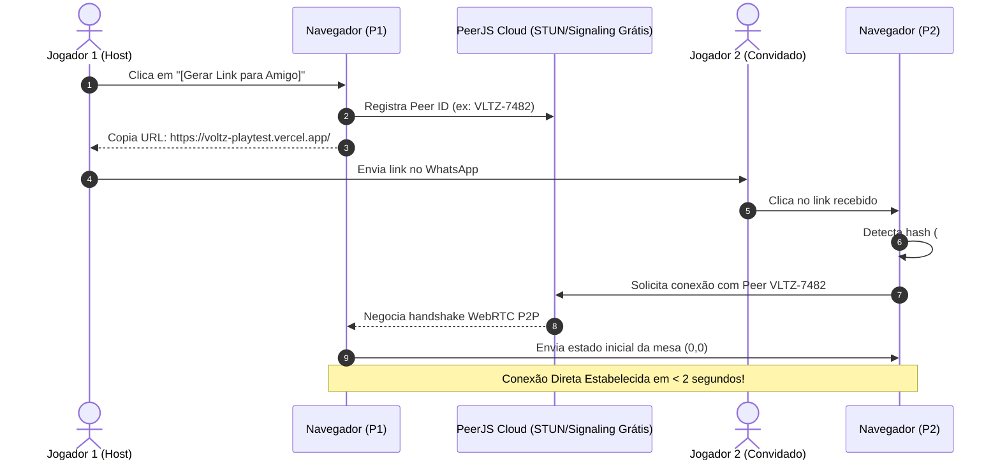

# ⚡ PLANO DE ARQUITETURA & IMPLANTAÇÃO ONLINE ZERO ATRITO
## Bancada de Testes VOLTZ — Multiplayer 2P via Link de WhatsApp (PeerJS WebRTC)

> **Objetivo Central:** Permitir que dois estudantes ou integrantes da equipe joguem juntos pela internet com **ZERO ATRITO** (sem cadastro, sem instalação, sem servidores pagos e com conexão instantânea ao clicar no link do WhatsApp).

---

## 🎛️ 1. ARQUITETURA DE CONEXÃO DIRETA POR LINK DE URL

### 🔄 O Fluxo "Clique & Jogue" (Zero Digitação)



---

## 💻 2. CÓDIGO JAVASCRIPT EXATO PARA AUTO-CONEXÃO (`game.js` / `index.html`)

Abaixo está o trecho padronizado para ler a URL e conectar automaticamente sem que o Jogador 2 precise digitar códigos:

```javascript
// =========================================================================
// AUTO-CONEXÃO VIA HASH DE URL (ex: https://site.com/#sala=VLTZ-4821)
// =========================================================================

// 1. Função para Gerar Link e Copiar para Área de Transferência
function gerarLinkWhatsApp() {
    const salaId = 'VLTZ-' + Math.floor(1000 + Math.random() * 9000);
    const urlCompleta = `${window.location.origin}${window.location.pathname}#sala=${salaId}`;

    // Inicia o Host PeerJS
    iniciarHostP2P(salaId);

    // Copia para o clipboard
    navigator.clipboard.writeText(urlCompleta).then(() => {
        alert(`Link copiado com sucesso!\n\nEnvie para seu amigo:\n${urlCompleta}`);
    }).catch(() => {
        prompt('Copie o link abaixo e envie para seu amigo:', urlCompleta);
    });
}

// 2. Leitura Automática ao Abrir a Página
function verificarConexaoAutomaticaPorURL() {
    const hash = window.location.hash; // ex: "#sala=VLTZ-4821"
    if (!hash) return false;

    const params = new URLSearchParams(hash.replace('#', ''));
    const salaId = params.get('sala');

    if (salaId) {
        console.log(`[P2P] Código de sala detectado na URL: ${salaId}. Conectando como convidado...`);
        iniciarClienteP2P(salaId);
        return true;
    }
    return false;
}

// Executar na inicialização do DOM
window.addEventListener('DOMContentLoaded', () => {
    const conectouPorLink = verificarConexaoAutomaticaPorURL();
    if (!conectouPorLink) {
        // Se não veio link na URL, abre o modal padrão de seleção de modo
        document.getElementById('mode-modal').style.display = 'flex';
    }
});
```

---

## 📡 3. O PROTOCOLO DE SINCRONIZAÇÃO EM 3 EVENTOS JSON

Para manter a comunicação ultra-leve e imune a latência, o jogo trafega apenas **3 mensagens JSON** pelo DataChannel do WebRTC:

```typescript
// 1. Mensagem enviada quando um jogador posiciona uma carta na grade
type MsgJogarCarta = {
    tipo: 'JOGAR_CARTA';
    jogadorId: 'p1' | 'p2';
    x: number;
    y: number;
    cartaUid: string;
    rotacao: 0 | 90 | 180 | 270;
};

// 2. Mensagem enviada quando um jogador descarta a mão e passa o turno
type MsgPassarVez = {
    tipo: 'PASSAR_VEZ';
    jogadorId: 'p1' | 'p2';
};

// 3. Mensagem enviada pelo Host para sincronizar a mesa completa (Handshake inicial ou reconexão)
type MsgSincronizarMesa = {
    tipo: 'SINCRONIZAR_MESA';
    grade: Record<string, CardNode>;
    monteRestante: number;
    vidasRede: number;
    turnoAtual: 0 | 1;
    analiseCircuito: CircuitAnalysis;
};
```

---

## 🌐 4. COMPARATIVO DAS OPÇÕES DE HOSPEDAGEM GRATUITA (1 CLIQUE)

| Plataforma | Tempo de Publicação | Link Gerado | HTTPS Automático | Como Atualizar |
| :--- | :--- | :--- | :--- | :--- |
| **🥇 Vercel (Recomendada)** | **30 segundos** | `febrace-voltz.vercel.app` | ✅ Sim (SSL Grátis) | Automático via Git (`git push`) |
| **🥈 Netlify Drop (Mais Rápida)** | **15 segundos** | `voltz-playtest.netlify.app` | ✅ Sim (SSL Grátis) | Arrastar a pasta no navegador |
| **🥉 GitHub Pages** | **1 minuto** | `davidlhferro.github.io/febrace` | ✅ Sim (SSL Grátis) | Ativar aba Settings no GitHub |

---

## 🚀 5. PASSO A PASSO PARA COLOCAR NO AR HOJE (EM 3 PASSOS)

### 🥇 Opção Recomendada: Vercel via CLI (Super Rápido)

1. **Passo 1 — Instalar CLI e Entrar na Pasta:**
   No PowerShell, execute:
   ```powershell
   cd C:\codigos\FEBRACE\01_Jogo_Voltz\bancada_playtest
   npx vercel
   ```

2. **Passo 2 — Confirmar as Perguntas Padrão:**
   - *Set up and deploy?* $\to$ `y`
   - *Which scope?* $\to$ Enter (sua conta)
   - *Link to existing project?* $\to$ `n`
   - *Project name?* $\to$ `voltz-playtest`
   - *In which directory is your code located?* $\to$ `./`
   - *Auto-detected Project Settings?* $\to$ Enter

3. **Passo 3 — Pegar o Link de Produção:**
   O terminal gerará instantaneamente o link público:
   `https://voltz-playtest.vercel.app/`
   
   *Pronto! Qualquer pessoa no mundo pode abrir o link e jogar.*

---

### 🥈 Opção Alternativa: Netlify Drop (Sem Linha de Comando)

1. Abra no navegador: [app.netlify.com/drop](https://app.netlify.com/drop)
2. Arraste a pasta `C:\codigos\FEBRACE\01_Jogo_Voltz\bancada_playtest/` para a janela do navegador.
3. Em 10 segundos o Netlify publica o site e entrega o link HTTPS público pronto para compartilhar no WhatsApp.

---

## 🔒 6. POR QUE O PEERJS É 100% GRATUITO E NÃO PRECISA DE SERVIDOR?

- **Servidor de Sinalização Gratuito:** O PeerJS disponibiliza o servidor público `0.peerjs.com` sem nenhum custo para realizar apenas o "aperto de mão" (troca de IPs) inicial.
- **Tráfego P2P Direto:** Assim que a conexão é estabelecida, os dados da partida trafegam **diretamente de celular para celular (ou PC para PC)** via WebRTC DataChannel com latência ultrabaixa (< 20ms) e sem consumir banda de nenhum servidor intermediário.
